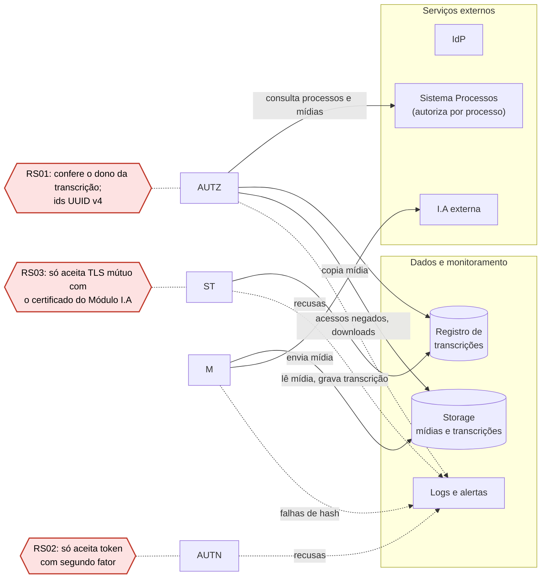

## Projeto da Arquitetura Segura

### Descrição

Este documento transforma os riscos prioritários da [análise de risco](etapa2-analise-de-risco.md) e os controles do [plano de tratamento](etapa2-tratamento-de-risco-nist.md) em requisitos de segurança e decisões de arquitetura. Ele responde como o serviço de transcrição seria organizado para reduzir esses riscos, em quatro partes: os requisitos de segurança derivados de três riscos altos ou muito altos, uma vulnerabilidade catalogada para cada requisito, o diagrama da arquitetura segura com a posição dos controles e as decisões de arquitetura que cumprem os requisitos.

---

### 1. Requisitos de segurança

Os riscos vêm da priorização da análise: RI01 e RI07 são MUITO ALTO (16), RI02, RI04 e RI13 são ALTO (12). RI07 fica de fora porque o plano o aceita. Reduzi-lo exigiria retirar o download e a exibição da transcrição. RI02 e RI03 ficam cobertos pelas mesmas decisões de RS01 (acesso decidido só pela sessão) e RS02 (validação do token no RQF1). Restam RI01, RI13 e RI04, um controle em cada ponto: autorização no Backend, autenticação do promotor e autenticação entre serviços. Cada requisito deriva do controle do plano de tratamento.

| ID | Risco de origem | Requisito de segurança | Critério de verificação |
| --- | --- | --- | --- |
| RS01 | RI01 (AME1) | O Backend deverá verificar, em toda rota que recebe um id de transcrição ou de chat (RQF4, RQF6 a RQF10), que o recurso pertence ao promotor da sessão antes de executar a operação, e deverá gerar esses ids como UUID v4, nunca sequenciais. | Com as sessões de dois promotores, A e B, cada uma dessas rotas chamada por A com um id de B responde acesso negado, não devolve nenhum dado do recurso, não altera nem exclui nada e gera um alerta. Ids criados em sequência são UUID versão 4 e não têm relação entre si. |
| RS02 | RI13 (AME13) | O Backend deverá criar a sessão (RQF1) somente a partir de token de identidade que comprove autenticação com segundo fator, pelo claim `amr` contendo `mfa` (RFC 8176) ou pelo valor de `acr` combinado com o provedor de identidade, e deverá recusar com erro de autenticação qualquer outro token, mesmo com assinatura, emissor, audiência e prazo válidos. | Um token assinado pelo provedor, com emissor, audiência e prazo válidos, mas sem a indicação de segundo fator, não cria sessão, recebe erro de autenticação e não abre nenhuma rota de dados. O mesmo token com `amr` contendo `mfa` cria a sessão. |
| RS03 | RI04 (AME4) | O endpoint de atualização de status (RQF4) deverá aceitar somente chamadas com TLS mútuo que apresentem o certificado de cliente exclusivo do Módulo I.A., emitido pela autoridade certificadora interna do serviço, e deverá receber apenas o id, o status e o hash do texto ou o motivo da falha. O caminho no Storage é derivado do id pelo próprio Backend, e nenhuma mudança é aceita depois do status finalizada, salvo o mesmo status repetido na reentrega da RQNF5.1. | Chamadas sem certificado, com certificado de outro serviço ou com certificado revogado são recusadas antes de qualquer leitura do registro; chamadas com campo de caminho ou que tentam mudar uma transcrição finalizada são recusadas sem alterar o registro. Cada recusa gera um alerta. A chamada com o certificado do Módulo I.A. e apenas os campos previstos atualiza o status. |

---

### 2. Vulnerabilidades catalogadas

Cada requisito recebe uma vulnerabilidade de catálogo reconhecido. A coluna de referência cita o CWE, a categoria do OWASP Top 10 e do OWASP API Security Top 10, os requisitos do OWASP ASVS 5.0 que a tratam e a cheat sheet da OWASP com a orientação de implementação. Os links estão na lista após a tabela.

| ID | Risco | Vulnerabilidade ou categoria | Referência utilizada | Requisito que trata | Relação com o sistema |
| --- | --- | --- | --- | --- | --- |
| V01 | RI01 (AME1) | Autorização contornada por chave controlada pelo usuário (IDOR, Broken Object Level Authorization) | CWE-639; OWASP Top 10 2021 A01, Broken Access Control; OWASP API Security Top 10 2023 API1, Broken Object Level Authorization; ASVS 5.0 8.2.2 e 8.3.1; OWASP Authorization Cheat Sheet | RS01 | O promotor vê o id das próprias transcrições em cada requisição (RQF4 a RQF10). Se o Backend carrega o registro só pelo id, sem conferir o promotor da sessão, o id de um colega abre, baixa, exclui ou leva ao chat a transcrição dele e revela em que processos o colega atua. Ids sequenciais (CWE-340) dispensam até o palpite, como no CAE1. |
| V02 | RI13 (AME13) | Autenticação de fator único | CWE-308; OWASP Top 10 2021 A07, Identification and Authentication Failures, item "missing or ineffective multi-factor authentication"; ASVS 5.0 6.3.3 e 10.3.4; OWASP Multifactor Authentication Cheat Sheet | RS02 | A conta do promotor é a institucional do provedor de identidade, e o Backend confere só a assinatura e o emissor do token (AME3). Se o provedor autentica apenas com senha, ou se o Backend aceita token emitido sem segundo fator, uma senha obtida por phishing ou reutilizada fora do MP vira sessão válida em todos os processos do promotor, com direito de apagar transcrições. |
| V03 | RI04 (AME4) | Falta de autenticação em função crítica | CWE-306; OWASP Top 10 2021 A07; OWASP API Security Top 10 2023 API2, Broken Authentication; ASVS 5.0 12.1.3 e 12.3.5; OWASP Microservices Security Cheat Sheet, seção de autenticação entre serviços, e Transport Layer Security Cheat Sheet, seção de certificados de cliente e TLS mútuo | RS03 | O endpoint de status existe para o Módulo I.A. (premissa 2 dos casos de uso), a interface não o usa e nenhum requisito o autentica. Qualquer host que alcance o Backend marca transcrições como finalizada e, como a chamada traz o caminho no Storage (CWE-73), aponta o registro para outro objeto; o promotor recebe um texto que não é o da mídia dele e pode usá-lo como prova. |

Referências:

- CWE-639, Authorization Bypass Through User-Controlled Key: <https://cwe.mitre.org/data/definitions/639.html>
- CWE-340, Generation of Predictable Numbers or Identifiers: <https://cwe.mitre.org/data/definitions/340.html>
- CWE-308, Use of Single-factor Authentication: <https://cwe.mitre.org/data/definitions/308.html>
- CWE-306, Missing Authentication for Critical Function: <https://cwe.mitre.org/data/definitions/306.html>
- CWE-73, External Control of File Name or Path: <https://cwe.mitre.org/data/definitions/73.html>
- OWASP Top 10 2021, A01 Broken Access Control: <https://owasp.org/Top10/2021/A01_2021-Broken_Access_Control/>
- OWASP Top 10 2021, A07 Identification and Authentication Failures: <https://owasp.org/Top10/2021/A07_2021-Identification_and_Authentication_Failures/>
- OWASP API Security Top 10 2023, API1 Broken Object Level Authorization: <https://owasp.org/API-Security/editions/2023/en/0xa1-broken-object-level-authorization/>
- OWASP API Security Top 10 2023, API2 Broken Authentication: <https://owasp.org/API-Security/editions/2023/en/0xa2-broken-authentication/>
- OWASP ASVS 5.0, V6 Authentication (6.3.3): <https://github.com/OWASP/ASVS/blob/master/5.0/en/0x15-V6-Authentication.md>
- OWASP ASVS 5.0, V8 Authorization (8.2.2, 8.3.1): <https://github.com/OWASP/ASVS/blob/master/5.0/en/0x17-V8-Authorization.md>
- OWASP ASVS 5.0, V10 OAuth and OIDC (10.3.4): <https://github.com/OWASP/ASVS/blob/master/5.0/en/0x19-V10-OAuth-and-OIDC.md>
- OWASP ASVS 5.0, V12 Secure Communication (12.1.3, 12.3.5): <https://github.com/OWASP/ASVS/blob/master/5.0/en/0x21-V12-Secure-Communication.md>
- OWASP Authorization Cheat Sheet: <https://cheatsheetseries.owasp.org/cheatsheets/Authorization_Cheat_Sheet.html>
- OWASP Multifactor Authentication Cheat Sheet: <https://cheatsheetseries.owasp.org/cheatsheets/Multifactor_Authentication_Cheat_Sheet.html>
- OWASP Microservices Security Cheat Sheet: <https://cheatsheetseries.owasp.org/cheatsheets/Microservices_Security_Cheat_Sheet.html>
- OWASP Transport Layer Security Cheat Sheet: <https://cheatsheetseries.owasp.org/cheatsheets/Transport_Layer_Security_Cheat_Sheet.html>
- RFC 8176, Authentication Method Reference Values: <https://www.rfc-editor.org/rfc/rfc8176>

---

### 3. Diagrama da arquitetura segura

O diagrama abaixo segue a arquitetura proposta. A tabela abaixo descreve cada identificador:

| Identificador | Componente | O que representa |
| --- | --- | --- |
| P | Promotor | O usuário do sistema |
| UI | Interface web | As telas que o promotor usa (mockups T1 a T6) |
| F | Fila | O enfileiramento que recebe os pedidos de transcrição |
| M | Módulo I.A | O worker Python que consome a fila e cuida da transcrição |
| IdP | Provedor de identidade | O SSO do MP, que confere a senha e emite o token de identidade. A sigla vem de Identity Provider |
| AUTN | Autenticação do backend | A parte do Backend que valida o token e cria a sessão (RQF1). Vem de authentication |
| AUTZ | Regras de autorização do backend | A parte do Backend que decide se o promotor pode acessar uma transcrição ou um processo. Vem de authorization |
| ST | Endpoint de status | O ponto do Backend que o Módulo I.A chama para atualizar o status da transcrição (RQF4) |

\
**Diagrama da arquitetura segura**

---

### 4. Decisões de arquitetura

As decisões arquiteturais abaixo definem como os requisitos de segurança serão implementados nos componentes do serviço de transcrição. Cada decisão está associada a um risco identificado e possui um critério de aceitação verificável.

| ID | Decisão | Rastreabilidade | Critério de aceitação |
|---|---|---|---|
| DA01 | Implementar autorização no Backend, utilizando a identidade do promotor autenticado para validar a propriedade de cada transcrição ou chat antes de permitir consultas, downloads, exclusões ou qualquer outra operação. Os identificadores dos recursos serão gerados como UUID v4. | RS01, V01, RI01 (AME1) | Realizar testes com dois promotores diferentes. O sistema deverá impedir que um promotor acesse, altere, baixe ou exclua recursos pertencentes ao outro. |
| DA02 | Integrar o Backend ao provedor de identidade institucional, exigindo autenticação multifator (MFA). O Backend deverá validar os dados do token de identidade e confirmar a presença da indicação de segundo fator antes de criar uma sessão. | RS02, V02, RI13 (AME13) | Enviar um token válido sem indicação de MFA e verificar que o Backend recusa a criação da sessão. Em seguida, enviar um token válido com MFA e verificar que a sessão é criada. |
| DA03 | Implementar autenticação entre serviços utilizando TLS mútuo (mTLS), com certificado digital exclusivo para o Módulo I.A. O Backend deverá validar o certificado antes de aceitar atualizações de status e controlar os campos que podem ser alterados. | RS03, V03, RI04 (AME4) | Realizar chamadas sem certificado, com certificado inválido e com certificado de outro serviço. Todas deverão ser recusadas. Uma chamada com certificado válido e campos permitidos deverá atualizar o status corretamente. |
