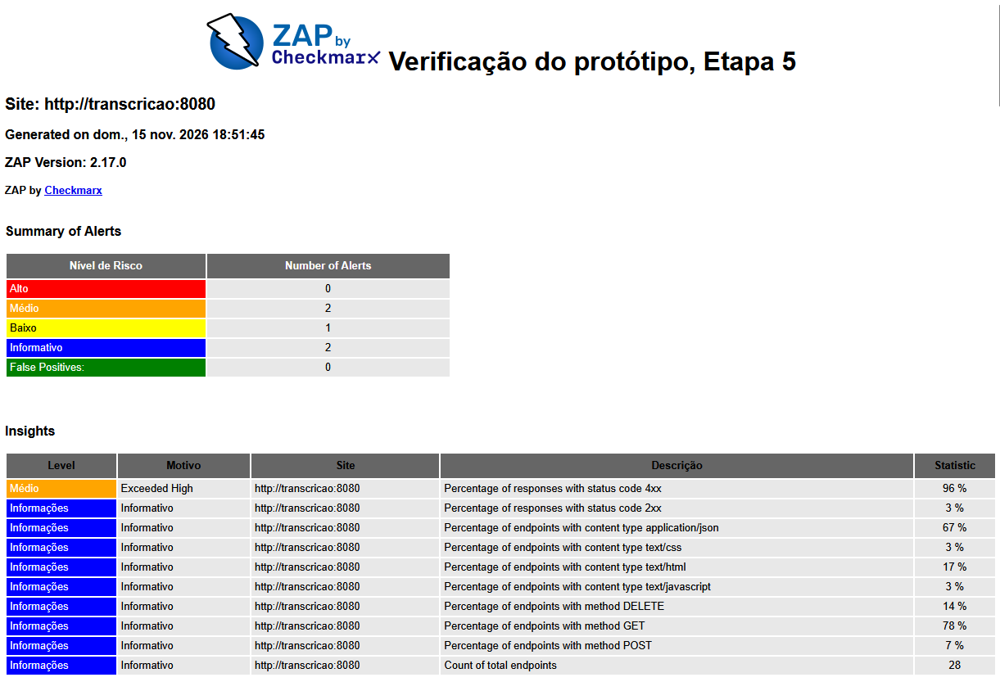

## Verificação de Vulnerabilidades

### Descrição

Este documento registra uma sessão de verificação dinâmica do protótipo da [Etapa 4](etapa4-codigo-seguro.md) com o ZAP, a ferramenta sugerida no enunciado. O alvo é o próprio sistema, não o Juice Shop: o protótipo implementa as duas práticas de código seguro e a interface, o que permite cruzar os alertas com os riscos da [análise de risco](etapa2-analise-de-risco.md) e os requisitos da [arquitetura segura](etapa3-arquitetura-segura.md). As seções seguem os seis itens do entregável mínimo: sistema testado, ferramenta, configuração do teste, evidência da execução, análise de três achados e correção proposta. A seção 6 explica os alertas descartados e o que o scanner não alcança.

---

### 1. Sistema testado

Protótipo do serviço de transcrição, na versão completa da Etapa 4: Backend Spring Boot com o filtro de sessão, as rotas de transcrição com autorização por propriedade (prática 2), a criação de sessão só com segundo fator (prática 1), o provedor de identidade simulado em `/idp-fake` e as páginas estáticas das telas T1, T3, T4 e T6. O chat temporário (T5) e o download em DOCX, acrescentados ao protótipo depois das práticas, ficam fora desta sessão. Dados iniciais de dois promotores e cinco transcrições. Tudo roda no Docker Compose do repositório, e o ZAP alcança a aplicação pelo nome interno `http://transcricao:8080`, sem sair da rede do compose. É um ambiente próprio, sem terceiros envolvidos.

---

### 2. Ferramenta

ZAP 2.17.0, pela imagem oficial `ghcr.io/zaproxy/zaproxy:stable`, como serviço `zap` do [compose do protótipo](../prototipo/compose.yaml), no perfil `verificacao`. O script [prototipo/zap/sessao.py](../prototipo/zap/sessao.py) controla o ZAP pela API e executa a sessão inteira com um comando, descrito no [README do protótipo](../prototipo/README.md).

---

### 3. Configuração básica do teste

| Item | Configuração |
| --- | --- |
| Modo | ZAP em daemon, proxy em `127.0.0.1:8090` dentro do contêiner, API sem chave e alcançável só de dentro |
| Contexto | `transcricao`, incluindo `http://transcricao:8080.*` |
| Autenticação | Regra `replacer` que injeta `Authorization: Bearer <token>` em toda requisição do spider e do scan ativo, com a sessão da promotora Ana criada pelo fluxo normal de login |
| Exclusão | `/api/sessao` fora do scan ativo, porque um `DELETE` encerraria a sessão que o próprio scan usa |
| Vetores de entrada | Query, corpo (incluindo JSON) e segmento de caminho, onde ficam os ids das transcrições |
| Política | Política padrão do ZAP, spider padrão, scan passivo em todo o histórico |
| Relatórios | `traditional-html` e `traditional-json` do ZAP, mais `alertas.md`, `trafego.log` e `sessao.txt` gerados pelo script |

A sessão tem quatro passos. Primeiro o script repete pelo proxy o fluxo da demonstração (login, lista, abrir, excluir), com o uso legítimo e os abusos das etapas 1 e 2: login sem segundo fator (TS01), token com o payload adulterado e a assinatura original, claim `amr` forjado, assinatura inválida, rotas de dados sem sessão, promotora abrindo e excluindo transcrição de colega e id inexistente (TS04), id fora do formato e exclusão durante o processamento. Depois rodam o spider, o scan passivo e o scan ativo com a sessão de Ana. Por fim o script grava os relatórios. O comando, na pasta `prototipo`:

```
docker compose up -d --force-recreate transcricao
docker compose run --rm zap
```

---

### 4. Evidência da execução

Os arquivos estão em [evidencias/etapa-5](../evidencias/etapa-5):

| Arquivo | Conteúdo |
| --- | --- |
| `zap-relatorio.html` | Relatório completo do ZAP, com descrição, instâncias e solução de cada alerta |
| `zap-relatorio.json` | O mesmo relatório em JSON |
| `alertas.md` | Resumo dos alertas por risco, com regra, ocorrências e exemplo de URL |
| `trafego.log` | As 38 chamadas do roteiro, com o status obtido e o esperado em cada uma |
| `sessao.txt` | Data, versão do ZAP, contexto, URLs cobertas, mensagens e duração |
| `relatorio-zap-resumo.png` e `relatorio-zap-alertas.png` | Capturas do relatório HTML |

Números da sessão de 15/11/2026: 23 URLs no contexto, 10.311 mensagens no histórico, das quais 10.241 do scan ativo, que durou 12 segundos. Nenhum alerta alto. Dois médios, um baixo e dois informativos:

| Risco | Alerta | Regra | Ocorrências |
| --- | --- | --- | --- |
| Médio | Content Security Policy (CSP) Header Not Set | 10038 | 6 |
| Médio | Missing Anti-clickjacking Header | 10020 | 6 |
| Baixo | X-Content-Type-Options Header Missing | 10021 | 18 |
| Informativo | Modern Web Application | 10109 | 5 |
| Informativo | Session Management Response Identified | 10112 | 2 |



O tráfego do roteiro terminou com todas as chamadas no status esperado. Trecho do `trafego.log`:

```
[ok] POST /api/sessao -> 401 (esperado 401). TS01: token válido sem mfa não cria sessão.
[ok] POST /api/sessao -> 200 (esperado 200). TS02: token com mfa cria a sessão de Ana.
[ok] POST /api/sessao -> 401 (esperado 401). Payload adulterado com a assinatura original.
[ok] GET /api/transcricoes/44d53d09-743b-4d99-89a0-d710f46c753c -> 403 (esperado 403). TS04: Beatriz tenta abrir transcrição de Ana.
[ok] GET /api/transcricoes/00000000-0000-0000-0000-000000000000 -> 403 (esperado 403). TS04: id inexistente recebe a mesma resposta.
```

A ausência dos cabeçalhos se confirma fora do ZAP, na resposta da aplicação (porta publicada nesta máquina):

```
$ curl -sI http://localhost:8080/index.html
HTTP/1.1 200
Last-Modified: Sun, 15 Nov 2026 15:54:32 GMT
Accept-Ranges: bytes
Content-Type: text/html
Content-Length: 2913

$ curl -sI http://localhost:8080/idp-fake/promotores
HTTP/1.1 200
Content-Type: application/json
Content-Length: 133
```

---

### 5. Análise dos achados

Pendente.

---

### 6. Alertas descartados e limites da verificação

Dois alertas informativos ficam fora da análise. "Modern Web Application" (regra 10109) só reconhece que as páginas carregam `app.js` e montam o conteúdo por script; é uma dica para usar o spider de cliente, não uma falha. "Session Management Response Identified" (regra 10112) identificou `tokenSessao` na resposta de `POST /api/sessao` como token de sessão. É o funcionamento esperado da prática 1: token opaco de 256 bits, guardado em memória no Backend e enviado pela interface no cabeçalho `Authorization`. Nada a corrigir.

O scan ativo não gerou alerta. As 10.241 requisições com injeção em query, no corpo JSON e nos segmentos de caminho (SQL, XSS, path traversal e injeção de comando, entre as regras da política padrão) voltaram sem indício de falha. Isso é coerente com o código: consultas JPA parametrizadas, ids tipados como UUID (fora do formato a resposta é 400, como no roteiro) e dados no DOM só por `textContent`.

Nenhum dos três achados é falso positivo, porque a ausência dos cabeçalhos está nas respostas. O que o scanner não mede é o impacto no protótipo, que é baixo: não há XSS conhecido e a sessão fica por aba. Em produção os três cabeçalhos são obrigatórios de qualquer forma.

O limite principal é que o ZAP não avalia lógica de negócio. RS01 (propriedade do recurso) e RS02 (segundo fator) estão fora do alcance de um scanner genérico, que não sabe qual promotor deveria ver qual transcrição nem o que o claim `amr` significa. A prova de que esses requisitos estão cumpridos é o `trafego.log`, com 401 em todo token sem `mfa`, adulterado ou inválido e 403 uniforme em id alheio ou inexistente, somado aos testes TS01 a TS06 da Etapa 4. Dois pontos do ambiente também ficam fora: o tráfego é HTTP sem TLS dentro do compose, então as regras de HSTS e de cookie seguro não se aplicam, e o provedor de identidade é simulado, então o fluxo real de login não foi exercitado.

---

### 7. Referências

- ZAP, alerta 10038, Content Security Policy (CSP) Header Not Set: <https://www.zaproxy.org/docs/alerts/10038/>
- ZAP, alerta 10020, Missing Anti-clickjacking Header: <https://www.zaproxy.org/docs/alerts/10020/>
- ZAP, alerta 10021, X-Content-Type-Options Header Missing: <https://www.zaproxy.org/docs/alerts/10021/>
- OWASP Top 10 2021, A05 Security Misconfiguration: <https://owasp.org/Top10/2021/A05_2021-Security_Misconfiguration/>
- OWASP Content Security Policy Cheat Sheet: <https://cheatsheetseries.owasp.org/cheatsheets/Content_Security_Policy_Cheat_Sheet.html>
- OWASP Clickjacking Defense Cheat Sheet: <https://cheatsheetseries.owasp.org/cheatsheets/Clickjacking_Defense_Cheat_Sheet.html>
- OWASP HTTP Headers Cheat Sheet: <https://cheatsheetseries.owasp.org/cheatsheets/HTTP_Headers_Cheat_Sheet.html>
- CWE-693, Protection Mechanism Failure: <https://cwe.mitre.org/data/definitions/693.html>
- CWE-1021, Improper Restriction of Rendered UI Layers or Frames: <https://cwe.mitre.org/data/definitions/1021.html>
