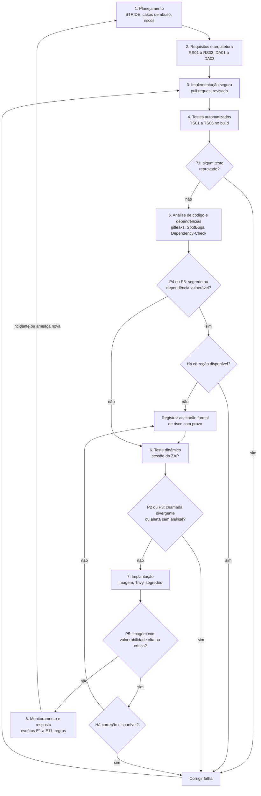

## Pipeline DevSecOps

### Descrição

Este documento planeja um pipeline DevSecOps para o serviço de transcrição. O pipeline não é implantado: o objetivo é mostrar em quais momentos do ciclo de desenvolvimento entram as atividades de segurança realizadas nas etapas 1 a 6, quais evidências elas produzem e quais verificações impedem o avanço para a etapa seguinte. Os oito momentos seguem o enunciado. Sete deles reaproveitam entregas anteriores; a análise de código e de dependências, ainda não realizada pelo projeto, é apresentada como proposta nas seções seguintes.

---

### 1. Visão geral

O diagrama abaixo relaciona os oito momentos do ciclo e os principais pontos de decisão do pipeline. Cada losango representa uma condição de parada; a saída de correção retorna à implementação segura, enquanto o avanço só ocorre depois que a falha é corrigida ou, em casos excepcionalmente autorizados, que uma decisão de risco fica registrada.

Os momentos 1 a 4 e 6 já possuem alguma evidência no projeto. Os momentos 5 e 7 são propostas desta etapa, porque ainda não há análise automática de código, dependências ou imagem no pipeline atual. O momento 8 está parcialmente implementado no protótipo: hoje, o token recusado (E2) e o acesso negado por propriedade (E5) são registrados.

Como melhoria sugerida ao fluxo, segredos devem ser procurados antes da compilação e no histórico do repositório. As imagens deverão ser promovidas pelo digest, não por uma tag mutável, e uma execução aprovada deverá conservar os relatórios dos scanners, o commit analisado e a decisão registrada para cada gate.

---

### 2. Momentos do pipeline

A tabela segue o modelo solicitado no enunciado. A última coluna estabelece o que precisa ser confirmado antes que o artefato possa avançar ao momento seguinte. A ocorrência de uma condição da seção 4 interrompe o avanço e encaminha o trabalho de volta à implementação, à análise da decisão ou à correção do controle.

| Momento | Atividade de segurança | Evidência produzida | Condição para continuar |
| --- | --- | --- | --- |
| 1. Planejamento | STRIDE, casos de abuso e análise de risco por probabilidade e impacto ([Etapa 1](etapa1-modelagem-ameacas.md), [Etapa 2](etapa2-analise-de-risco.md)) | Tabelas AME1 a AME16, casos CAE1 a CAE7 e registros RI01 a RI16 | Riscos MUITO ALTO e ALTO com tratamento decidido no [plano NIST](etapa2-tratamento-de-risco-nist.md), por redução ou aceitação formal |
| 2. Requisitos e arquitetura | Requisitos de segurança, vulnerabilidades catalogadas e decisões de arquitetura ([Etapa 3](etapa3-arquitetura-segura.md)) | RS01 a RS03, V01 a V03 com CWE, DA01 a DA03 e diagrama da arquitetura segura | Cada risco priorizado ligado a um requisito com critério de aceitação verificável |
| 3. Implementação segura | Sessão somente com segundo fator e autorização por propriedade ([Etapa 4](etapa4-codigo-seguro.md)) | Código do [protótipo](../prototipo) e pull request revisado | Pull request aprovado por integrante diferente daquele que realizou a alteração |
| 4. Testes automatizados | TS01 a TS06 executados no build da imagem e no serviço `testes` do compose | Saída reproduzível do `mvn test` e dos testes do protótipo | Todos os testes passam (P1); o `Dockerfile` impede a geração da imagem quando há falha |
| 5. Análise de código e dependências | Busca de segredos, análise estática e verificação de dependências (seção 3) | Relatórios do gitleaks, do SpotBugs com FindSecBugs e do OWASP Dependency-Check | Nenhum segredo exposto (P4) e nenhuma dependência vulnerável alta ou crítica sem decisão registrada (P5) |
| 6. Teste dinâmico | Sessão do ZAP com roteiro de uso legítimo e abusos ([Etapa 5](etapa5-verificacao-vulnerabilidades.md)) | `zap-relatorio.html`, `alertas.md` e `trafego.log` em [evidencias/etapa-5](../evidencias/etapa-5) | Nenhuma chamada divergente no roteiro (P2), nenhum alerta alto e os médios com análise registrada (P3) |
| 7. Implantação | Varredura da imagem com Trivy, segredos fora do código e da imagem e TLS mútuo no endpoint de status definido por RS03 | Imagem versionada, digest associado ao commit, SBOM e relatório do Trivy | Nenhuma vulnerabilidade alta ou crítica sem decisão registrada (P5), sem execução como usuário root |
| 8. Monitoramento e resposta | Eventos E1 a E11 e regras de detecção ([Etapa 6](etapa6-deteccao-de-intrusoes.md)) | Logs de auditoria, alertas, registro de incidente e histórico de revisão das regras | Alertas tratados conforme a resposta definida na Etapa 6 e regras revisadas após falsos positivos |

A sequência termina apenas em uma imagem aprovada e em monitoramento contínuo. Um incidente observado em operação ou uma ameaça nova reinicia o fluxo no momento 1, atualizando a modelagem de ameaças antes da próxima implementação.

Como melhorias sugeridas ao projeto, os artefatos devem ser associados ao SHA do commit e à versão dos scanners. O momento 7 pode promover uma imagem pelo digest aprovado em vez de uma tag mutável, mantendo o retorno automático para uma versão anterior conhecida como segura.

---

### 3. Análise de código, dependências e imagem

Nenhuma etapa anterior analisou o código-fonte ou as bibliotecas do protótipo. Para cobrir esse momento, o pipeline incluiria quatro ferramentas gratuitas:

| Ferramenta | O que procura | Onde entra | Quando falha |
| --- | --- | --- | --- |
| gitleaks | Segredos no código e no histórico do git | Pre-commit e primeiro passo do pipeline | Qualquer achado (P4) |
| SpotBugs com FindSecBugs | Padrões inseguros no código Java | Fase `verify` do Maven | Achado de segurança de prioridade alta sem justificativa |
| OWASP Dependency-Check | Dependências do `pom.xml` com CVE publicada | Fase `verify` do Maven | CVSS 7 ou maior sem decisão registrada (P5) |
| Trivy | Vulnerabilidades na imagem final; gera também o SBOM | Depois do `docker build` | Alta ou crítica sem decisão registrada (P5) |

No case, a `nimbus-jose-jwt`, que valida o token da prática 1, e a `poi-ooxml`, que gera o .docx do RQF8, processam dados vindos de fora, e uma falha nelas atinge um controle ou um dado sigiloso. O protótipo não guarda segredos no repositório, mas a implementação completa teria a credencial da fila, a chave da I.A externa e os certificados do TLS mútuo; um vazamento da credencial da fila é o cenário do CAE5. O SBOM, lista dos componentes da imagem com suas versões, fica guardado com o digest e o commit, para saber sem novo build se uma vulnerabilidade publicada depois atinge a imagem em produção.

---

### 4. Condições que param o pipeline

Definimos cinco, identificadas de P1 a P5; são os códigos que aparecem nos losangos do diagrama da seção 1 e na última coluna da tabela da seção 2. Todas estão ligadas a riscos e evidências do projeto:

| ID | Condição | Momento | Como é detectada | Por que para |
| --- | --- | --- | --- | --- |
| P1 | Teste de segurança reprovado | 4 | `mvn test`, no build da imagem ou no serviço `testes` | Um dos TS01 a TS03 reprovado significa sessão aberta sem segundo fator (RI13); um dos TS04 a TS06, acesso à transcrição de outro promotor (RI01) |
| P2 | Falha no controle de acesso na aplicação em execução | 6 | Linha `[DIVERGENTE]` no `trafego.log` do ZAP, ou resposta 2xx a uma rota de transcrição chamada com a sessão de outro promotor | Os testes podem passar e a aplicação implantada, com outra configuração, abrir a rota; é a V01 em execução |
| P3 | Alerta alto do ZAP, ou alerta médio sem análise e decisão registradas | 6 | `alertas.md` da sessão | Na Etapa 5, os dois alertas médios (10038 e 10020) só foram aceitos depois da análise e da correção proposta |
| P4 | Segredo encontrado no repositório | 5 | gitleaks | Um segredo no histórico do git continua exposto mesmo depois de apagado do arquivo, e precisa ser revogado e trocado |
| P5 | Dependência ou imagem com vulnerabilidade alta ou crítica sem decisão registrada | 5 e 7 | OWASP Dependency-Check e Trivy | Uma biblioteca vulnerável pode anular um controle, como a validação do token da prática 1 |

Uma condição só deixa de bloquear de duas formas: a falha é corrigida e a verificação passa, ou, quando não há correção disponível (por exemplo, uma vulnerabilidade sem versão corrigida da biblioteca), o grupo registra no pull request a decisão de aceitar o risco, com justificativa e prazo de revisão, como o plano NIST fez com RI07, RI10 e RI14. A aceitação vale só para P3 e P5. P1, P2 e P4 sempre exigem correção: teste reprovado e controle de acesso falho indicam que um requisito de segurança não está sendo cumprido, e um segredo exposto precisa ser revogado e trocado, porque continua no histórico do git mesmo depois de apagado do arquivo. Por isso, no losango do diagrama que reúne P4 e P5, o caminho de aceitação de risco se aplica apenas à dependência vulnerável.

---

### 5. Referências

- NIST SP 800-218, Secure Software Development Framework (SSDF): <https://csrc.nist.gov/pubs/sp/800/218/final>
- OWASP DevSecOps Guideline: <https://owasp.org/www-project-devsecops-guideline/>
- OWASP Top 10 2021, A06 Vulnerable and Outdated Components: <https://owasp.org/Top10/A06_2021-Vulnerable_and_Outdated_Components/>
- OWASP Dependency-Check: <https://owasp.org/www-project-dependency-check/>
- SpotBugs: <https://spotbugs.github.io/>
- Find Security Bugs: <https://find-sec-bugs.github.io/>
- gitleaks: <https://github.com/gitleaks/gitleaks>
- Trivy: <https://trivy.dev/>
- ZAP: <https://www.zaproxy.org/>
- CWE-798, Use of Hard-coded Credentials: <https://cwe.mitre.org/data/definitions/798.html>
